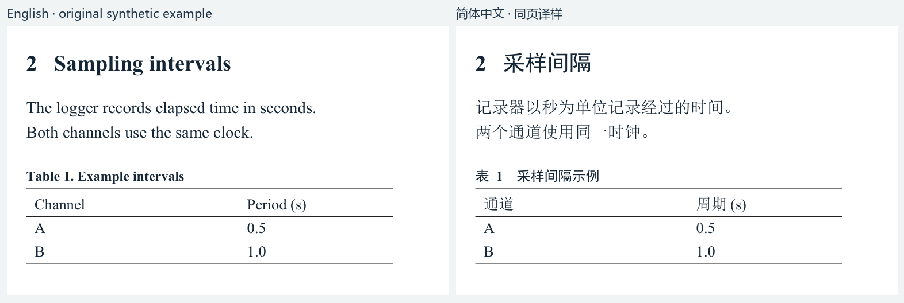

# Aviation Technical Translation for Codex

[简体中文](README.zh-CN.md)

Translate English civil-aviation papers and manuals into Simplified Chinese. The installable **aviation-technical-translation 1.2.2-rc7** skill covers source layout, terminology, figures, tables, equations, long-document checkpoints and independent review.

1. [Download the installable ZIP](downloads/aviation-technical-translation-1.2.2-rc7.zip) and its [SHA-256 checksum](downloads/SHA256SUMS.txt), or use the versioned URLs in the [installation prompt](skills/aviation-technical-translation/prompts/INSTALL_PROMPT.md).
2. Paste the installation prompt into Codex. It installs the skill and QA role for the current user, checks the selected fonts and runs a headless PDF smoke test.
3. Start a translation with the English source and the [recommended prompt, Chinese or English](skills/aviation-technical-translation/prompts/TRANSLATION_PROMPT.md). Edit its first JSON block to change fonts, sizes and line spacing.

Body text defaults to SimSun 12 pt on an 18 pt baseline, Chinese headings to SimHei, and Western text to Times New Roman. Set `allow_sparse_adjustment` to false for exact sizes. The recommended execution and acceptance setting is `gpt-6.2-sol/high`; independent QA defaults to `gpt-6.2-sol/medium`. High QA is scoped to documented difficult items. Verification uses file and command-line tools, with Computer Use disabled.



This original example shows a two-line paragraph and its table rendered at the same scale. For long work, [checkpoint and resume batches](skills/aviation-technical-translation/references/long_translation.md) and [verify the final page typography](skills/aviation-technical-translation/references/typography_and_headless_qa.md). The optional [Word export path](skills/aviation-technical-translation/references/word_runtime_setup.md) requires local operator setup. Fonts and third-party runtimes are installed separately.

## Standalone review core

The original `aviation-translation-core` v0.1.1 CLI and synthetic demo are available at the repository root. The following sections describe that standalone core.

## What it checks

- Explicit terminology forms, required/forbidden target strings, ordered numbers, declared units/identifiers/symbols and markers.
- A supported text PDF against source-unit mappings; source/target unit completeness, footnote body references and table coordinate/content bindings.
- Input hashes, scope and rule bindings; synthetic QA handoff consistency and recheck/decision records.

It is not an automatic translator, authoritative glossary, Word/PDF publication system, general scientific parser, PDF security scanner or trusted independent-review platform. It has no trusted host-QA adapter. A snapshot validates its binding contract; it does not replace running the terminology and invariant checks. A second JSON record is not an independent reviewer.

## Start here

Follow the [Windows quickstart](docs/quickstart.md) to select compatible Python, create a private isolated environment, install locked dependencies and run the original offline demo plus the existing tests. No Git knowledge is needed. With `$py` and the fresh `$demo` directory prepared there, the demo entry is:

```powershell
& $py -X utf8 -I -B examples/run_demo.py --output $demo
if ($LASTEXITCODE -ne 0) { throw 'Demo failed; stop and inspect private output.' }
```

The demo produces four summaries and private synthetic input files. `mechanical_status=PASS`, `completion=BLOCKED_PENDING_REAL_QA`, `human_approved=false` and `released=false` can coexist by design. PASS covers a particular mechanical check, not semantic adequacy, full-document release or actual human approval. Do not share private source/target registries or generated PDFs.

## Supported environment and limits

The recorded Windows environment uses CPython 3.12.14, pypdf 6.19.0 and jsonschema 4.26.0; all seven pinned packages are in [requirements.lock](requirements.lock). Lock hashes are artifact-specific. Arbitrary Python versions, platforms and architectures are not promised. Supplemental Linux execution does not verify installing this Windows lock on Linux.

The R1 Windows regression record is 98 passed, zero failures, one file-symlink test NOT_TESTED due to privilege restrictions (99 total). This is candidate engineering history, separate from the original private workflow's use history. Do not elevate permissions to make a test green. See the [contract and numeric limits](docs/input_contract.md) and [manual input preparation](docs/preparing_inputs.md). Unsupported notation or document layers require explicit unresolved review; mechanical PASS cannot clear them.

## Documentation and provenance

- [Contribution scope](CONTRIBUTING.md), [security handling](SECURITY.md), [unreleased changes](CHANGELOG.md), [roadmap](ROADMAP.md).
- [Translation rules](references/translation_policy.md), [terminology](references/terminology_disambiguation.md), [QA handoff](references/dual_agent_workflow.md), [evidence binding](references/evidence_contract.md), [QA policy](references/qa_policy.md).
- [Provenance](docs/provenance.md) and [third-party dependency provenance](docs/dependency_provenance.json).

Source provenance is `USER_REPORTED_AI_ASSISTED`, not an exclusive-authorship guarantee. The maintainer declares no coauthors or rights/confidentiality agreements (`USER_DECLARATION`), not a legal audit or third-party-rights assurance. Institutional material and old machine translations are excluded; the prior service remains unknown and is not integrated. No official endorsement is claimed.

## License and attribution

Copyright (c) 2026 Hug800mhz. The project's own core, rules/documentation and original examples are provided under the standard [MIT License](LICENSE). Third-party dependencies retain their respective licenses; this grant does not cover input documents or other parties' materials. Preserve the copyright and permission notices in all copies or substantial portions as required by LICENSE. Optional acknowledgement does not replace these notices.

The standalone review core is v0.1.1. The release status does not alter the MIT permissions supplied with this copy. See [third-party notices](THIRD_PARTY_NOTICES.md) for the reviewed source-only dependency scope and the separate terms governing user-installed dependencies.

### Acknowledgement (optional)

When building on this project, a link back to Aviation Translation Core is appreciated. This acknowledgement is optional and does not add to or replace the requirements of the MIT License.
